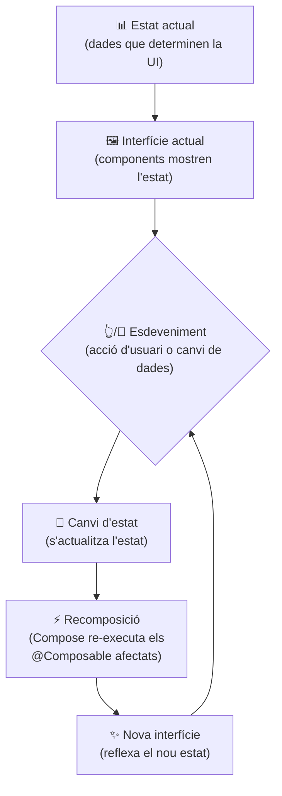

# Jetpack Compose

## 1. Estat i recomposició

En Compose, la interfície depén de l'**estat** de l'aplicació i no de canvis manuals.

### 1.1 Què és l'estat?

L'**estat** és la informació que pot canviar durant l'execució de l'aplicació i que pot afectar la interfície.

Per exemple:

- El valor d'un comptador;
- El text introduït en un camp;
- Si una opció està seleccionada;
- Si un element està activat.

Quan l'estat canvia, Compose detecta el canvi i recompon les parts de la interfície que depenen d'aquest estat.

### 1.2 Com funciona la recomposició?

La **recomposició** és el procés pel qual Compose torna a executar les funcions `@Composable` que depenen d'un estat que ha canviat.

No és necessari reconstruir tota la interfície: Compose actualitza només les parts afectades pel canvi.

Quan l'estat d'una aplicació canvia, Compose segueix aquest procés:

1. **Estat actual:** Compose parteix de les dades que determinen què ha de mostrar la interfície.
2. **Interfície actual:** Els components mostren la informació corresponent a aquest estat.
3. **Esdeveniment:** L'usuari realitza una acció o es produeixen canvis en les dades.
4. **Canvi d'estat:** L'estat s'actualitza com a conseqüència de l'esdeveniment.
5. **Recomposició:** Compose torna a executar els components afectats pel canvi d'estat.
6. **Nova interfície:** La interfície s'actualitza per reflectir el nou estat.



> 💡 **Idea clau:** Compose no actualitza manualment cada component. Quan canvia l'estat, recompon les parts de la interfície que depenen d'aquest estat.

## 2. Conservar un valor entre recomposicions: `remember`

En una recomposició, la funció `@Composable` es torna a executar. Si creem un valor directament dins de la funció, aquest es torna a inicialitzar a cada recomposició.

`remember` fa que el valor es conserve entre recomposicions:

```text
@Composable
fun Ajuda() {
    var mostrarAjuda by remember {
        mutableStateOf(false)
    }

    Column {
        Button(onClick = {
            mostrarAjuda = !mostrarAjuda
        }) {
            Text("Ajuda")
        }

        if (mostrarAjuda) {
            Text("Escriu el teu nom en aquest camp.")
        }
    }
}
```

> 💡 **Idea clau:** `remember` no crea l'estat. El que fa és conservar el valor creat dins de la composició perquè no es torne a inicialitzar en cada recomposició.

## 3. Estat observable: `mutableStateOf`

Perquè Jetpack Compose puga detectar els canvis d'una dada, cal crear un **estat observable** amb `mutableStateOf()`.

```kotlin
val comptador = mutableStateOf(0)
```

En aquest cas, `comptador` és un estat que comença amb el valor `0`.

Per **consultar** el valor de l'estat utilitzem `.value`:

```kotlin
Text("Comptador: ${comptador.value}")
```

Per **modificar** el valor també utilitzem `.value`:

```kotlin
comptador.value++
```

Ara ja podem escriure un comptador complet. Fixa't que `mutableStateOf` va **dins de `remember`**: si no, l'estat es recrearia a cada recomposició i el comptador tornaria sempre a `0`.

```kotlin
@Composable
fun Comptador() {
    val comptador = remember {
        mutableStateOf(0)
    }

    Column {
        Text("Comptador: ${comptador.value}")

        Button(onClick = {
            comptador.value++
        }) {
            Text("Incrementar")
        }
    }
}
```

Quan `comptador.value` canvia, Compose detecta el canvi i recompon els elements que utilitzen aquest estat.

> 💡 **Idea clau:** `mutableStateOf()` crea un estat observable i `.value` permet consultar-lo o modificar-lo. Perquè l'estat sobrevisqui a les recomposicions, cal envoltar-lo amb `remember`.

> ⚠️ **Atenció:** crear un `mutableStateOf` sense `remember` dins d'un `@Composable` fa que l'estat es reinicialitze a cada recomposició. L'exemple següent **no funcionaria** com a comptador:
>
> ```kotlin
> val comptador = mutableStateOf(0) // ❌ es recrea a cada recomposició
> ```

## 4. Accedir a l'estat amb `by`

Quan utilitzem `mutableStateOf()`, podem accedir al valor de l'estat mitjançant `.value`:

```kotlin
val comptador = remember {
    mutableStateOf(0)
}

Text("Comptador: ${comptador.value}")

comptador.value++
```

Kotlin permet utilitzar `by` per simplificar aquesta sintaxi:

```kotlin
var comptador by remember {
    mutableStateOf(0)
}

Text("Comptador: $comptador")

comptador++
```

Amb `by`, no cal escriure `.value` cada vegada que volem consultar o modificar l'estat.

| Amb `.value`        | Amb `by`      |
| ------------------- | ------------- |
| `comptador.value`   | `comptador`   |
| `comptador.value++` | `comptador++` |

> 📌 **Apunt:** amb `by` cal declarar la variable amb `var`, perquè el valor es reassigna. Amb `val` no es pot modificar.

> 💡 **Idea clau:** `by` no crea ni conserva l'estat. Simplement permet treballar amb el valor de l'estat d'una manera més còmoda.

## 5. Composició nova: `rememberSaveable`

Fins ara hem vist que `remember` permet conservar un estat durant les **recomposicions**.

Però hi ha situacions en què la composició actual es destrueix i se'n crea una de nova. Per exemple, quan es gira el dispositiu, la pantalla s'ha de tornar a construir.

En aquests casos, un valor guardat només amb `remember` es pot perdre.

Si volem conservar determinats valors també quan la composició es recrea, podem utilitzar `rememberSaveable`.

Per exemple, en un formulari pot interessar conservar el nom que ha escrit l'usuari:

```kotlin
@Composable
fun Formulari() {
    var nom by rememberSaveable {
        mutableStateOf("")
    }

    TextField(
        value = nom,
        onValueChange = {
            nom = it
        },
        label = { Text("Nom") }
    )
}
```

Si l'usuari escriu `Anna`, el valor es conserva durant les recomposicions i, en una recreació de la composició, `rememberSaveable` el recupera.

No hem d'utilitzar sempre `rememberSaveable`. La pregunta que ens hem de fer és:

**Necessite conservar aquest valor si la composició es recrea?**

- **No** → `remember`
- **Sí** → `rememberSaveable`, sempre que el valor es puga guardar.

> 📌 **Apunt:** `rememberSaveable` només pot guardar tipus que es puguen posar dins d'un `Bundle` (tipus primitius, `String`, `Parcelable`, `Serializable`, llistes d'aquests…).

|                            | `remember`         | `rememberSaveable`        |
| -------------------------- | ------------------ | ------------------------- |
| Recomposició               | Conserva l'estat   | Conserva l'estat          |
| Recreació de la composició | Pot perdre l'estat | Pot recuperar l'estat     |
| Ús habitual                | Estat temporal     | Dades que volem conservar |

> 💡 **Idea clau:** `remember` conserva l'estat entre recomposicions. `rememberSaveable` permet conservar determinats estats també quan la composició es recrea.

> 🤔 **Per pensar:** si l'usuari escriu el seu nom en un formulari i gira el mòbil, què passa amb el text si uses `remember`? I si uses `rememberSaveable`?

## 6. Col·leccions observables

Quan treballem amb una llista que forma part de l'estat de la interfície, podem utilitzar `mutableStateListOf()`.

A diferència de `mutableStateOf()`, no tenim un únic valor amb `.value`, sinó una **llista observable** que podem modificar directament.

```kotlin
val elements = remember {
    mutableStateListOf<String>()
}

Button(onClick = {
    elements.add("Nou element")
}) {
    Text("Afegir")
}
```

Quan modifiquem la llista, Compose detecta el canvi i pot recompondre les parts de la interfície que depenen d'ella.

Per exemple:

```kotlin
val elements = remember {
    mutableStateListOf("Un", "Dos")
}

Column {
    for element in elements {
        Text(element)
    }

    Button(onClick = {
        elements.add("Nou")
    }) {
        Text("Afegir")
    }
}
```

> 💡 **Idea clau:** `mutableStateOf()` permet observar un valor, mentre que `mutableStateListOf()` permet observar els canvis d'una llista.

| Funció                 | Què crea              | Accés                       |
| ---------------------- | --------------------- | --------------------------- |
| `mutableStateOf()`     | Un estat amb un valor | `.value` o `by`             |
| `mutableStateListOf()` | Una llista observable | Directament sobre la llista |

> 📌 **Apunt:** també podem utilitzar una `List` normal amb elements que tinguen el seu propi estat observable, però `mutableStateListOf()` simplifica la gestió de l'estat de la llista.

## 7. Recomposició selectiva

Quan un estat canvia, Compose **no** torna a executar tota la interfície: només re-executa els `@Composable` que han llegit aquest estat.

Compose fa un seguiment de quins àmbits de composició (**recomposition scopes**) llegeixen cada estat. Quan l'estat canvia, només es marquen per recompondre's aquells àmbits que l'han llegit. Això s'anomena **recomposició selectiva** o **smart recomposition**.

```kotlin
@Composable
fun Pantalla() {
    var comptador by remember { mutableStateOf(0) }

    Text("Això no canvia")          // ❌ no es re-executa
    Text("Comptador: $comptador")   // ✅ es re-executa
    Button(onClick = { comptador++ }) {
        Text("+1")
    }
}
```

> 💡 **Idea clau:** un `@Composable` només es recompon si llegeix un estat que ha canviat. La resta de la interfície es manté intacta.

## 8. State hoisting

El **state hoisting** consisteix a moure l'estat d'un component a un component pare.

D'aquesta manera, el component fill no és responsable de guardar l'estat, sinó que rep el valor i una funció per modificar-lo.

```kotlin
@Composable
fun CampNom(
    nom: String,
    onNomChange: (String) -> Unit
) {
    TextField(
        value = nom,
        onValueChange = onNomChange
    )
}
```

El component pare manté l'estat:

```kotlin
var nom by remember {
    mutableStateOf("")
}

CampNom(
    nom = nom,
    onNomChange = {
        nom = it
    }
)
```

Això facilita la reutilització dels components i fa que l'estat estiga en un lloc clar i controlat.

> 💡 **Idea clau:** un component és més reusable quan no guarda el seu propi estat, sinó que el rep com a paràmetre i notifica els canvis cap al pare.

## 9. Data Class

### RememberSaveable

`RememberSaveable` no pot guardar una `data class` personalitzada. Hi hauria que usar `@Parcelize`

```kotlin
@Parcelize
data class Usuari(val nom: String, val edat: Int) : Parcelable
```

> Per a importar Parcelize haurem d'afegir al gradle/libs.version.toml:
>
> ```kotlin
> [plugins]
> kotlin-parcelize = { id = "org.jetbrains.kotlin.plugin.parcelize", version.ref = "kotlin" }
> ```
>
> i al app/build.gradle.kts
>
> ```kotlin
> plugins {
>     alias(libs.plugins.kotlin.parcelize) 
> }
> ```

### Llistes observables

Quan tenim una llista de `data class` i volem modificar un element no podem aplicar el canvi directament sobre un dels atributs, hem de fer una còpia de l'element i substituir-lo.

```kotlin
val usuaris = remember { 
    mutableStateListOf(Usuari(...), Usuari(...)) 
}
usuari[0] = usuari[0].copy(nom = "Pepe")
```

> 💡 **Idea clau:** les `data class` són **immutables per defecte** (camps `val`) i es comparen per valor. Això encaixa amb el model d'estat de Compose: en lloc de mutar, **crees còpies** i reassignes.

## 10. Taula resum

| Eina                 | Per a què serveix                                     |
| -------------------- | ----------------------------------------------------- |
| `mutableStateOf`     | Crear un estat observable simple                      |
| `remember`           | Conservar un valor entre recomposicions               |
| `rememberSaveable`   | Conservar un valor també quan la composició es recrea |
| `mutableStateListOf` | Crear una llista observable                           |
| `by`                 | Sintaxi curta per a `.value`                          |
| State hoisting       | Moure l'estat cap al pare per reutilitzar components  |
